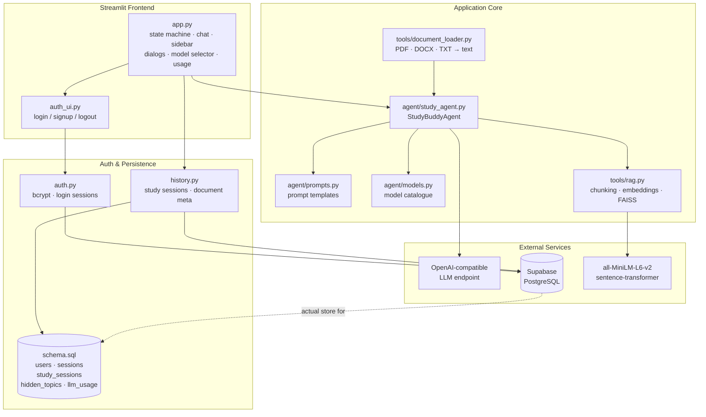
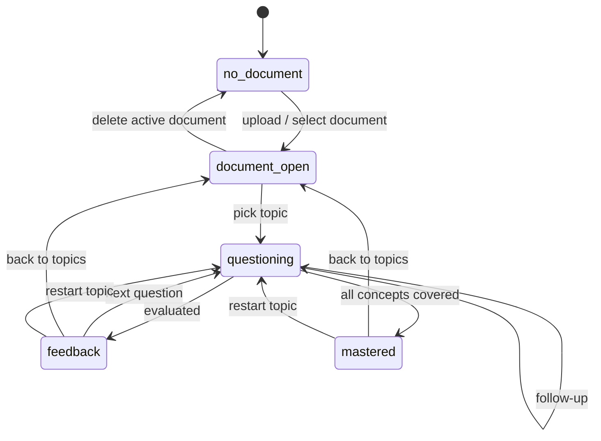
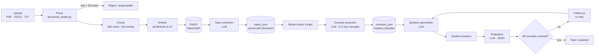
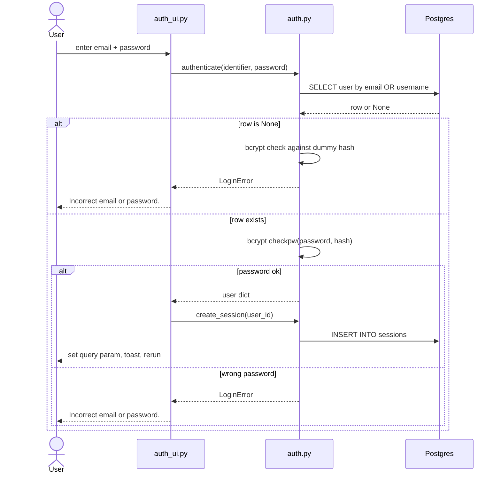
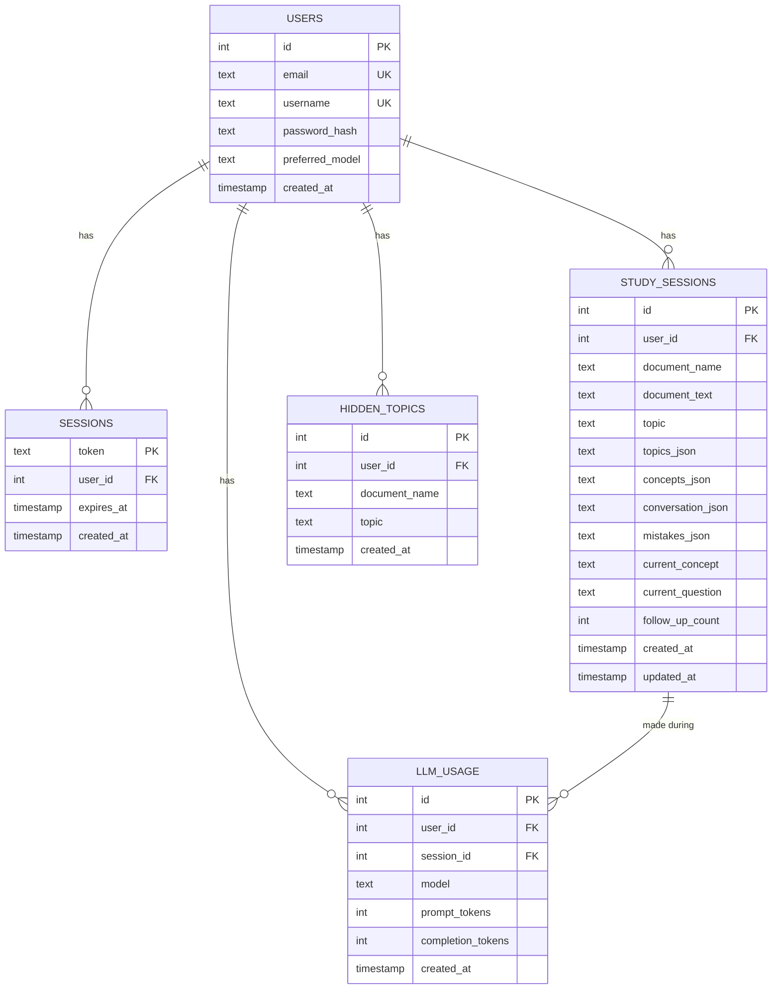
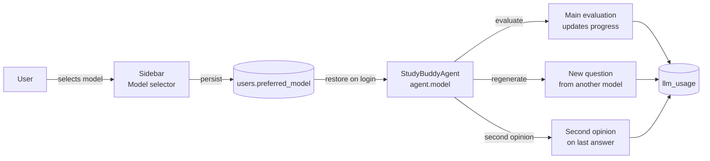
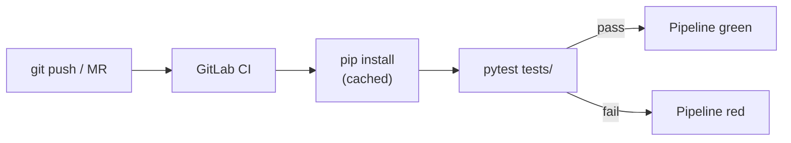

# StudyBuddy — AI Learning Partner

An AI-powered study assistant that quizzes you on your own lecture materials using RAG and LLM feedback.

## How it works

1. Upload your lecture notes or slides (PDF, Word, or plain text)
2. StudyBuddy extracts the main topics automatically
3. Select a topic — StudyBuddy asks you a comprehension question based on your material
4. Explain the concept in your own words
5. Get instant feedback and targeted follow-up questions until the topic is mastered

## Setup

### 1. Clone the repository

```bash
git clone https://github.com/your-username/study-buddy.git
cd study-buddy
```

### 2. Install dependencies

```bash
pip install -r requirements.txt
```

### 3. Configure your API key

Copy the example env file and fill in your credentials:

```bash
cp .env.example .env
```

Then open `.env` and set your values:

```
API_KEY=your-api-key-here
BASE_URL=https://chat.kiconnect.nrw/api/v1
MODEL=OpenAI-GPT-5-Mini
```

> If you are using a different OpenAI-compatible API, replace `BASE_URL` and `MODEL` accordingly.

### 4. Run the app

Open your terminal (Command Prompt or PowerShell) and navigate to the project folder:

```bash
cd "C:\path\to\study-buddy"
```

For example, if you cloned it to your D drive:

```bash
cd "D:\study-buddy"
```

Then run:

```bash
streamlit run app.py
```

The app will open automatically in your browser at `http://localhost:8501`.

## Supported file types

- PDF (`.pdf`)
- Word (`.docx`)
- Plain text (`.txt`)



## 2. Application State Machine



## 3. Processing Pipeline



## 4. Authentication Flow



## 5. Persistence (ER Diagram)



## 6. Multi-Model Support



## 7. CI Pipeline


